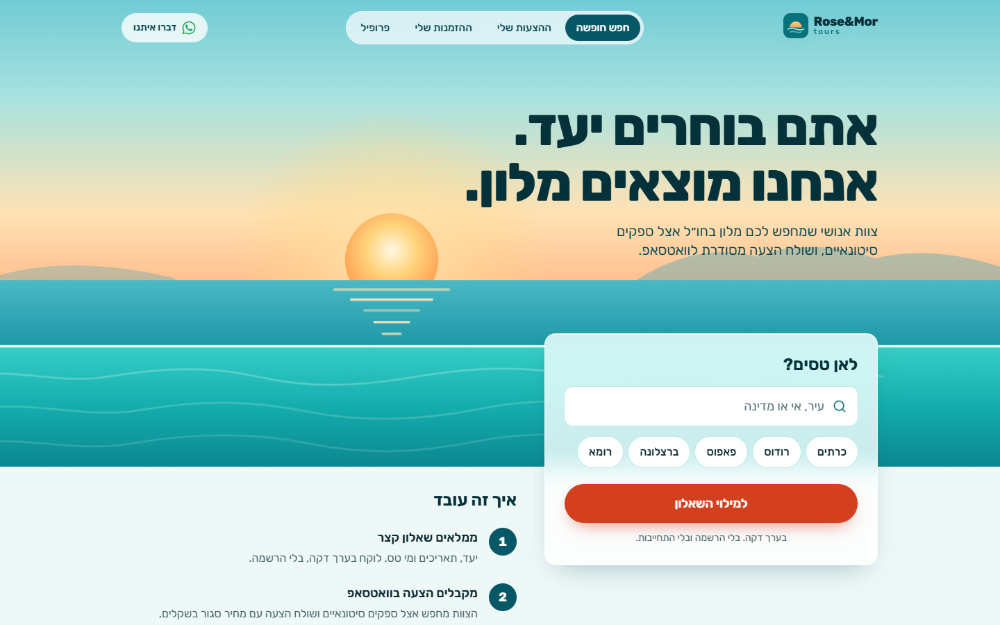

# Rose&Mor tours

**A booking app for a small travel agency that finds hotels abroad at wholesale prices.** The customer fills in a one-minute questionnaire, the team searches its suppliers and sends a personal offer over WhatsApp, and the customer books it in the app. Hebrew (RTL), installable as an app on iOS and Android.



| | |
|---|---|
|  |  |

## What it does

**For customers**
- **One-minute questionnaire, no sign-up**: destination (220 destinations, with the spellings Israelis use), dates and flexibility, travelers and rooms, stars, board basis. Guests get an anonymous session; signing in with Google later keeps their requests through a one-time claim token.
- **A personal offer page** at `/o/<token>`: hotel, photos, room, our price against the market price, the cancellation terms and when the offer expires. Offer links shared on WhatsApp show the hotel in their preview card.
- **Booking**: travelers and passport photos, uploaded only into the customer's own unpaid booking. Passports are deleted automatically 30 days after the trip, 7 days after a cancellation, or 14 days after an offer runs out unbooked.
- **Push notifications** when an offer or a voucher is ready.

**For the team**
- Requests and bookings as list and detail, side by side on desktop, with status tabs.
- **An offer form that follows the business rules**: no dates in the past, a cancellation deadline on or before arrival, a market price above ours, one live offer per request, expiry capped at the arrival day. Hotel names autocomplete from a catalog of 933 hotels in 88 destinations and from past offers.
- One tap sends the offer over WhatsApp with a ready message (a `wa.me` link, no paid API).
- Team management with three roles: customer, admin and owner.

## How it's built

| | |
|---|---|
| Front end | React 19, TypeScript, Vite, React Router, TanStack Query, Tailwind CSS v4 |
| App | PWA with its own service worker: precaching, Web Push, install sheets for iOS and Android |
| Hosting | Cloudflare Workers static assets, free tier. A small Worker renders the preview card for offer links and runs a daily keep-alive cron so the free database never pauses |
| Back end | Supabase: Postgres, Auth (anonymous and Google), Storage, an Edge Function, pg_cron |

**Security lives in the database, not the UI.**
- Every table has row-level security. Default privileges revoke everything, and each grant is explicit.
- A custom access token hook puts the role in the JWT, so policies read it from the token instead of querying `profiles` on every row. Only the owner can change roles (a trigger enforces it).
- The business rules are constraints and triggers; the UI turns their refusals into plain Hebrew.
- Passports and vouchers are in private buckets, reachable only by their booking's customer and by staff through short-lived signed URLs. A nightly pg_cron job calls an Edge Function that deletes expired passports through the Storage API.

```
src/features/   search (questionnaire), requests, offer, bookings, profile, auth, admin (staff panel)
src/data/       destinations and the hotel catalog
worker/         offer link previews and the keep-alive cron
supabase/       migrations (schema, RLS, business rules) and the passports-cleanup function
```

## Run it

Needs Node.js 22+ and a Supabase project.

```bash
npm install
cp .env.example .env                       # Supabase URL and publishable key, the business's WhatsApp number
cp wrangler.example.jsonc wrangler.jsonc   # your Cloudflare account and the same Supabase values
npm run dev
```

**Database:** apply `supabase/migrations` in order. In the Supabase dashboard, enable anonymous sign-ins and the Google provider, and set `public.custom_access_token_hook` as the custom access token hook. For passport cleanup, deploy `supabase/functions/passports-cleanup`, store a random `passports_cleanup_token` in Vault, and put your project's ref in the cron URL of the `passports_cleanup` migration.

**Deploy:** `npm run deploy` builds and deploys to Cloudflare Workers. The build stops if `.env` is missing a required value, so the site can't ship without the real WhatsApp number.

© 2026 Hananel Sabag
